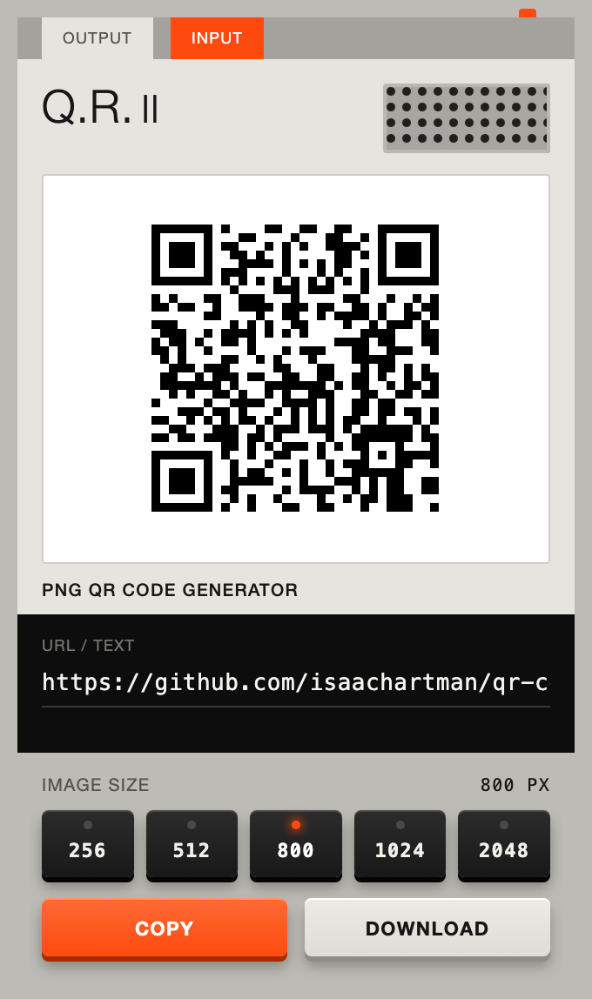

# QR Code Generator

A small Chrome extension that turns the current page, or any URL or text you type, into a QR code. Copy it to the clipboard or save it as a PNG.

## Features

- QR code for the current tab's URL the moment you open the popup
- Edit the field to encode any other URL or text; the code updates as you type
- **Copy** the image to the clipboard or **Download** it as `qrcode.png`
- Choose the exported image size: 256, 512, 800, 1024 or 2048 px (remembered between uses)
- Works offline and sends nothing anywhere
- Styled after the Teenage Engineering K.O. II

## Install

The extension isn't on the Chrome Web Store, so load it unpacked:

1. Clone or download this repository.
2. Open `chrome://extensions` and turn on **Developer mode**.
3. Click **Load unpacked** and choose this folder.
4. Pin the extension from the puzzle-piece menu for one-click access.

## Notes

- The only permission is `activeTab`, used to read the current tab's URL when you click the toolbar icon.
- The QR code is always drawn black on white with a 4-module quiet zone and error correction level M, so it scans reliably.
- Very long text won't fit in a QR code; the popup says so instead of drawing one.

## License

[MIT](LICENSE)

## Credits

QR encoding by [qrcode-generator](https://github.com/kazuhikoarase/qrcode-generator) by Kazuhiko Arase (MIT), bundled as `qrcode.js`.
